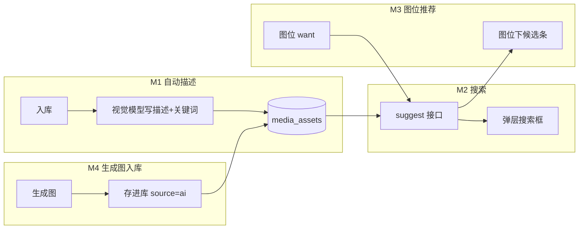

# 图片素材闭环 · 设计文档

日期：2026-08-23
状态：待实现
交付对象：AI 开发者（本文档自足，不依赖会话上下文）

## 0. 一句话目标

写笔记拆图后，每个图位自动从素材库推荐实拍图；推荐不满意可搜一句话；库里没有就生成；生成得好的一键存回库。核心抽象：**图片是资产，笔记是引用，描述由机器写，查询用人话。**

## 1. 项目背景（现状）

这是一个自托管的创作者工具（repo：`creator-inbox`），生产环境跑在 NAS Docker 容器 `wechat-inbox`（`http://192.168.31.126:8877`）。相关现状：

- **素材库**（`server/library.js`）：SQLite 表 `media_assets`（约 215 张图 + 874 条视频，来源 `nas` 扫描或 `upload` 上传），有缩略图、分面标签系统（`taxonomy_nodes` / `asset_annotations`，图片基本没打过标）。
  - `GET /api/library/assets` 支持 `type/source/q/tag/sort/limit/offset`，`q` 目前只 LIKE `file_path` 和 `original_tags`。
  - `POST /api/library/upload?filename=x.jpg`（body 为文件原始字节）→ 入库返回 `{ok, asset:{id,...}}`。
- **做笔记**（`server/notes.js` + `src/components/NoteTab.tsx`）：素材文本 → Kimi 起草正文 → 拆成 6 个图位（slot）。每个 slot 有 `role`（封面/图2…）、`want`（中文一句话，这张要出什么）、`prompt`（出图提示词）。
  - 图位可以放库里的实拍（`POST /api/notes/from-library {id}` 把库图复制成 `data/notes/{imageId}.jpg`），也可以生成（`POST /api/notes/generate-one`，走 Mac 上的 Hermes 出图桥，支持以 `imageId` 为底图 img2img）。
  - 生成的图只存在 `data/notes/` 下，**不在库里**，用完即沉没。
- **选图弹层**（`src/components/PhotoPicker.tsx`）：刚改成"按文件夹（专辑）浏览"，左侧专辑列表（由 `file_path` 前端推导），右侧缩略图格子，点选预览后放进图位。**保留它作为兜底浏览。**
- **LLM 配置**（`server/notes.js` 的 `llmConfig()`）：按优先级读 `KIMI_API_KEY` / `MOONSHOT_API_KEY` / `DEEPSEEK_API_KEY` / `OPENAI_API_KEY`，调 `${base}/chat/completions`。生产 NAS 的 `/data/.env` 里配了 Kimi。Moonshot 平台有视觉模型可用（同一个 chat/completions 接口，消息里带 `image_url` 内容块）。

## 2. 要做什么（四个里程碑）

每个里程碑独立可上线、可验收。按顺序做。



---

## 3. M1 · 入库自动描述

### 3.1 数据迁移

在 `server/library.js` 建表语句后追加幂等迁移（SQLite 无 `ADD COLUMN IF NOT EXISTS`，用 try/catch 包裹）：

```sql
ALTER TABLE media_assets ADD COLUMN ai_caption TEXT DEFAULT '';
ALTER TABLE media_assets ADD COLUMN ai_keywords TEXT DEFAULT '';   -- 逗号分隔
ALTER TABLE media_assets ADD COLUMN captioned_at INTEGER DEFAULT 0;
```

### 3.2 描述生成

新增模块 `server/caption.js`（不要塞进 library.js，它已经 450 行了）：

- `captionImage(filePath | buffer) → {caption, keywords[]}`
- 输入用**缩略图**（`thumb_path` 已有，几十 KB）而不是原图，省 token 和带宽；没有缩略图的用原图缩到长边 768 再传。
- 调用与 `notes.js` 相同的 chat/completions 接口。LLM 配置读取逻辑从 `notes.js` 的 `llmConfig()` 提出来放进 `server/llm.js` 共享（`notes.js` 改为引用它，行为不变）。
- 视觉模型名用环境变量 `LIB_VISION_MODEL`，默认 `moonshot-v1-8k-vision-preview`。
- Prompt（system）：

```
你在给民宿创作者的图片素材库写检索用描述。看图输出 JSON：
{"caption":"一句中文，30字内，说清内容+场景+构图/光线","keywords":["3到6个检索词"]}
关键词偏名词和场景词（如 院子/夜景/俯拍/海鲜/餐桌/特写），不要形容词堆砌，不要重复 caption 原句。
只输出 JSON。
```

- 失败（超时/非 JSON）：记日志，`captioned_at` 保持 0，等下次补跑。**入库流程绝不因描述失败而失败。**

### 3.3 触发点

1. **上传时**：`handleUpload` 成功后异步触发 caption（fire-and-forget，不阻塞响应）。
2. **扫描时**：`indexOne` 对新图片同样异步触发。视频跳过（本期只做图片）。
3. **存量回填**：新增接口
   - `POST /api/library/caption-backfill` → 启动后台任务，串行处理所有 `file_type='image' AND captioned_at=0` 的资产，间隔 ≥500ms（防限流）。返回 `{ok, queued}`。
   - `GET /api/library/caption-status` → `{running, done, total, errors:[]}`（参考现有扫描任务 `scan` 的进度结构）。
4. 素材库页（`src/LibraryTab.tsx`）工具条加一个「补描述」按钮 + 进度条（复用扫描进度条样式 `.lib-scanbar`）。

### 3.4 验收

- 上传一张新图，几秒后 `GET /api/library/assets?q=<描述里的词>` 能命中它。
- 跑一次 backfill，215 张存量的 `ai_caption` 非空率 > 95%。

---

## 4. M2 · 搜索

### 4.1 扩展现有 q

`listAssets` 的 `q` 条件扩成：

```sql
(m.file_path LIKE ? OR m.original_tags LIKE ? OR m.ai_caption LIKE ? OR m.ai_keywords LIKE ?)
```

### 4.2 新增 suggest 接口（给推荐和搜索框共用）

`GET /api/library/suggest?q=<人话>&limit=8&type=image`

中文没有空格分词，用**反向匹配**（简单、无依赖、对 200~2000 张的库足够快）：

1. 取全部 `file_type='image'` 且 `status='indexed'` 的资产（内存里遍历，带 `ai_caption/ai_keywords/original_tags/file_path/source/shoot_time`）。
2. 逐张打分：
   - 该资产的每个 keyword 若是查询串的子串（`q.includes(kw)`）：**+3**
   - caption 与查询串的公共 2-gram 数（对 caption 和 q 各切双字滑窗，取交集大小）：**每个 +1，上限 +6**
   - `original_tags` 或专辑名（`file_path` 倒数第二层目录，去掉 `NN_` 前缀）命中查询子串：**+2**
   - 来源加权：`source IN ('nas','upload')`（实拍）**+1**，`source='ai'` **+0**（实拍优先）
3. 得分 0 的丢弃；按分数降序、同分按 `shoot_time` 降序；返回 `{list:[{id,thumb_path,file_path,ai_caption,source,score}], total}`。

### 4.3 弹层加搜索框

`PhotoPicker.tsx` 顶部加一个输入框：

- 有输入 → 调 suggest，格子显示结果（替代专辑过滤），下方专辑列表仍可点（点专辑即清空搜索）。
- 空输入 → 回到现状（专辑浏览）。
- 300ms 防抖。

### 4.4 验收

- 搜「院子 晚上」能命中描述含院子夜景的图，且实拍排在 AI 图前面。

---

## 5. M3 · 图位候选推荐

### 5.1 交互

`NoteTab.tsx` 中每个已拆图的 slot（有 `want`、还没放图 `!imageId`）：

- 展开态（`open`）下，在「放一张」按钮旁自动展示一行候选条：调 `suggest?q=<want>&limit=3`，渲染 3 张小缩略图 + 每张下面一行来源角标（AI 图标 `AI`）。
- 点候选缩略图 → 直接走现有 `POST /api/notes/from-library {id}` → 放进该图位（复用 `placeFromLibrary` 逻辑，但目标 slot 就是当前 slot）。
- 候选为空（suggest 返回 0 条）→ 该行不渲染，保持现状（主按钮引导生成）。
- 候选行尾放一个「更多」链接 → 打开 PhotoPicker，**搜索框预填该 slot 的 want**（给 PhotoPicker 加 `initialQuery?: string` prop）。

### 5.2 请求时机与缓存

- slot 首次展开时请求一次，结果按 `slotId+want` 缓存在组件 state；`want` 被人工编辑后失效重取（防抖 500ms）。
- 不要在拆图完成时一次性并发 6 个请求；按需（展开时）取。

### 5.3 验收

- 拆图后展开某个 slot，能看到 ≤3 张相关实拍候选；点一张即入位；编辑 want 后候选跟着变。

---

## 6. M4 · 生成图入库

### 6.1 接口

`POST /api/library/save-note-image`，body：

```json
{ "imageId": "notes 目录里的图 id", "caption": "可选，默认用该图位的 want", "keywords": ["可选"] }
```

服务端（`server/library.js` 挂新路由，`server/index.js` 注入读取 notes 图片的能力，参考现有 `readLibraryImage` 的反向做法）：

1. 从 `data/notes/{imageId}.jpg` 读文件，复制进 `uploadDir`（文件名 `ai_{imageId}.jpg`）。
2. 插入 `media_assets`：`source='ai'`，`ai_caption=caption`，`ai_keywords`，`shoot_time=now()`，生成缩略图。
3. 已存过（同 imageId 重复提交）→ 幂等返回已有 asset。

`listAssets` 的 `source` 过滤白名单从 `nas|upload` 扩成 `nas|upload|ai`。

### 6.2 UI

`NoteTab.tsx`：图位当前图是**生成图**（有 `imageId` 且无 `photoId`）时，slot 操作区加「存进库」链接按钮：

- 点击 → 调 save-note-image（caption 默认传该 slot 的 `want`）→ 成功后按钮变「已在库」并禁用。
- PhotoPicker 与候选条里，`source='ai'` 的图左上角渲染小角标 `AI`（样式参考现有 `.ptag`）。

### 6.3 验收

- 生成一张图 → 存进库 → 在弹层搜索该 slot 的 want 能搜到它，带 AI 角标；重复点「存进库」不产生重复资产。

---

## 7. 明确不做（本期范围外）

- 不做向量/embedding 检索（库太小，2-gram 反向匹配够用；将来超过几千张再议）。
- 不做视频描述。
- 不动人工 taxonomy 标签系统（保留现状，不推广也不删除）。
- 不做「最近使用/已发布图」的沉淀层（M1–M4 验证后再说）。
- 不改 Hermes 出图桥。

## 8. 工程约定

- **风格**：跟随现有代码。服务端 CommonJS、无框架、`db.prepare` 直写 SQL；前端 React + 手写 CSS（墨纸风：零圆角零阴影，变量见 `src/style.css` 顶部）；中文 UI 文案，口语化（参考「放一张」「用这张生」）。
- **测试**：`npm test`（node --test）。给 `caption.js` 的打分/解析逻辑和 `suggest` 打分函数写单测（LLM 调用 mock 掉）；参考 `server/tests/notes.test.js` 的写法。
- **文档**：新接口补进 `docs/API.md` 的表格。
- **构建**：`npm run build`（tsc --noEmit + vite build）必须过。
- **部署**（人工执行，文档里不用自动化）：`rsync server/*.js` 和 `dist/` 到 NAS `ALIVE@192.168.31.126:/home/ALIVE/wechat-inbox/`，然后 `docker restart wechat-inbox`。容器内不能跑 `/api/update/apply`。
- **环境变量**（NAS `/data/.env` 已有 KIMI_API_KEY）：新增可选 `LIB_VISION_MODEL`（默认 `moonshot-v1-8k-vision-preview`）。

## 9. 涉及文件一览

| 文件 | 动作 |
|---|---|
| `server/llm.js` | 新建：从 notes.js 提出 `llmConfig()` 共享 |
| `server/caption.js` | 新建：视觉描述生成 + 回填任务 |
| `server/library.js` | 迁移字段、q 扩展、suggest、save-note-image、caption 路由挂载 |
| `server/notes.js` | 改用 `server/llm.js`（行为不变） |
| `server/index.js` | 注入依赖（notes 图片目录路径给 library） |
| `src/components/PhotoPicker.tsx` | 搜索框、`initialQuery` prop、AI 角标 |
| `src/components/NoteTab.tsx` | 图位候选条、「存进库」按钮 |
| `src/LibraryTab.tsx` | 「补描述」按钮 + 进度 |
| `src/style.css` | 候选条、角标、搜索框样式 |
| `server/tests/` | caption 解析、suggest 打分单测 |
| `docs/API.md` | 新接口表格 |

## 10. 总验收路径（端到端）

1. 空跑 backfill，确认存量图有描述。
2. 写一条素材 → 起草 → 拆图。
3. 展开「封面」图位：看到实拍候选 → 点一张入位。
4. 展开某个没有候选的图位 → 生成 → 「存进库」。
5. 再做一条类似笔记 → 上一步存的 AI 图出现在候选里（带 AI 角标、排在实拍后）。
